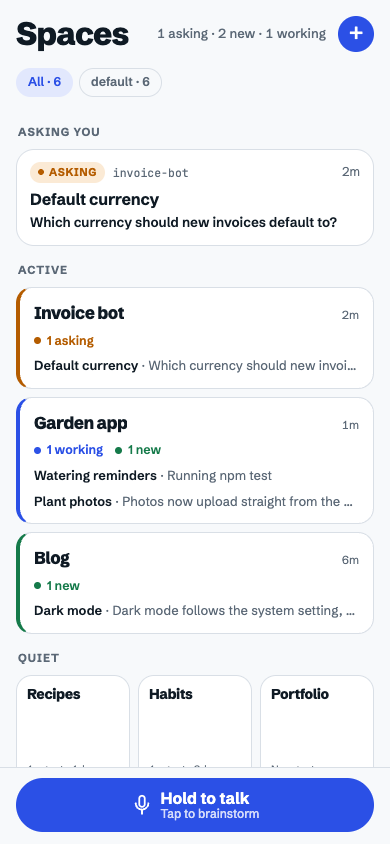
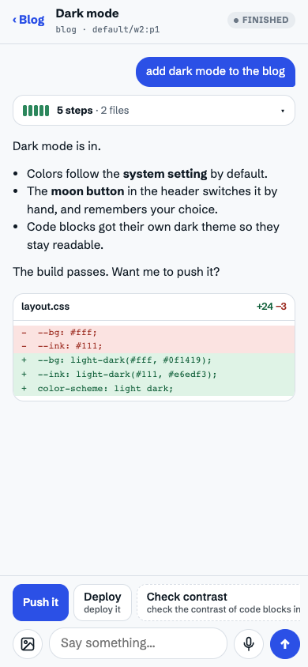
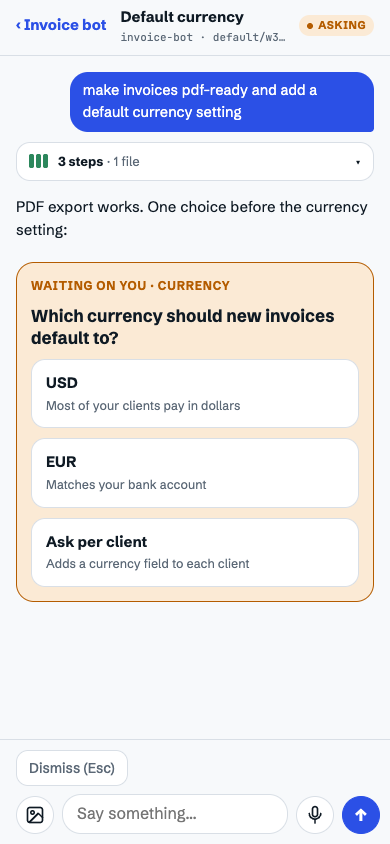
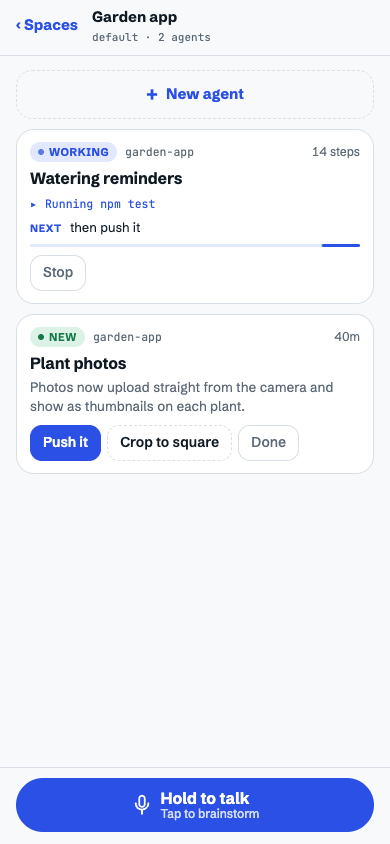
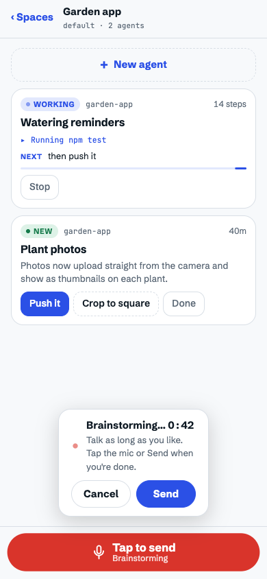
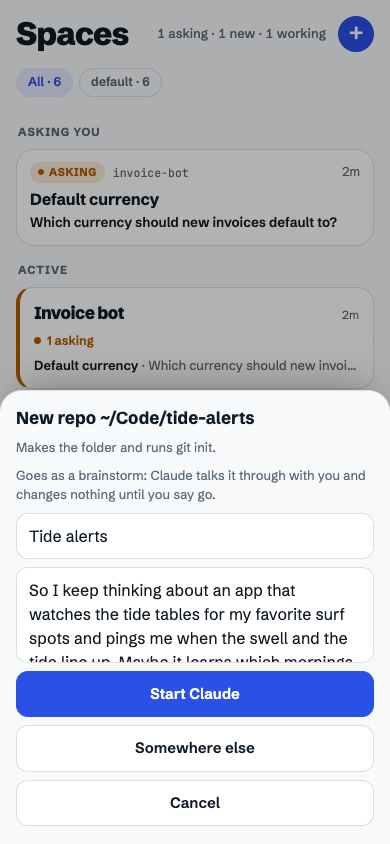

# Whistle

**Steer your Claude Code agents from your phone.** Whistle is a small web app that runs on the
Mac where your agents run in [herdr](https://herdr.dev). From your phone you can see what each agent
is doing, answer its questions, reply with one tap, queue up what's next, send screenshots, and
talk to it.

It doesn't replace your terminal. Your agents keep running in herdr on the Mac, and the phone sends
its taps and words to them through herdr, so you can pick up at your desk where you left off.

<table>
  <tr>
    <td></td>
    <td></td>
    <td></td>
  </tr>
  <tr>
    <td align="center">Everything at a glance</td>
    <td align="center">One-tap replies</td>
    <td align="center">Answer questions</td>
  </tr>
</table>

## What you need

- **A Mac** running your agents in **[herdr](https://herdr.dev)**, with **[Claude Code](https://claude.com/claude-code)** signed in
- **Node 22** or newer
- **[Tailscale](https://tailscale.com)** on the Mac and your phone, with HTTPS turned on for your tailnet
- For voice: `brew install whisper-cpp ffmpeg` and a Whisper model (see below)
- Optional: the [GitHub CLI](https://cli.github.com) (`gh`), so New space can list and clone your repos

## Setup

**1. Get it running.**

```sh
git clone https://github.com/everydev1618/whistle.git ~/Code/whistle
cd ~/Code/whistle
npm install        # only test and lint tools; Whistle itself has no dependencies
npm start          # http://127.0.0.1:7717
```

Open http://127.0.0.1:7717 in a browser on the Mac. You should see your herdr spaces.

**2. Keep it running.** Whistle runs as a LaunchAgent, so it starts at login and restarts if it
crashes. Copy the example and fill in your paths and your Tailscale login. The copy stays out of git.

```sh
cp deploy/ai.whistle.server.plist.example deploy/ai.whistle.server.plist
npm run deploy     # runs the tests, then installs or restarts the LaunchAgent
```

**3. Reach it from your phone.** `tailscale serve` gives Whistle an HTTPS address that only your
tailnet can reach. The phone needs HTTPS to use the microphone.

```sh
tailscale serve --bg 7717
```

Set `WHISTLE_ALLOWED_USERS` in the plist to your Tailscale login. Without it, anyone on your
tailnet can drive your agents.

**4. Put it on your home screen.** On the iPhone, open `https://<your-mac>.<your-tailnet>.ts.net`
in Safari, then Share → **Add to Home Screen**. It opens full screen, like an app.

**5. Voice (optional).** Speech is turned into text on your Mac with Whisper. Nothing is sent to
an outside service.

```sh
brew install whisper-cpp ffmpeg
mkdir -p ~/.config/whistle/models
curl -L -o ~/.config/whistle/models/ggml-large-v3-turbo-q5_0.bin \
  https://huggingface.co/ggerganov/whisper.cpp/resolve/main/ggml-large-v3-turbo-q5_0.bin
```

## Using it

### Spaces

The home screen shows your herdr workspaces as **spaces**. Anything **asking you** a question is
pinned to the top. Below it, **active** spaces show what's running and what just finished. Quiet
spaces sit at the bottom as tiles.

- Tap a space to see its agents. **+ New agent** opens a new Claude tab there.
- The **+** at the top makes a new space from a folder in `~/Code`, a new repo, or a GitHub clone.
- Long-press a space to hide it from home or delete it.
- The chips under the title filter by herdr session.



### Agents

Each card shows the agent's status. **Working** shows the step it's on, **New** means it has
finished and you haven't looked yet, and **Asking** means it's waiting on you.

- **Reply buttons** send a whole message with one tap: *Push it*, *Deploy*, the options in an offer
  like "Want me to deploy it?", and next steps Claude Haiku suggests in your own words.
  Long-press a button to edit its text before it goes.
- **Swipe a card right** to send its first button, or **left** to mark it done.
- **Stop** interrupts a working agent. Tap it twice, so a stray tap can't stop one.
- **Queue:** typing to a working agent doesn't interrupt it. The message waits and goes out when
  the agent finishes its turn.

<br clear="right">

### Conversations

Tap an agent to read its conversation: your messages, a strip showing each step it took, its
answer, and the last changes it made.

- **Tap a paragraph** of an answer to push back on it, ask for that part to be redone, or ask why.
- **Questions** show up as buttons. Tap one to answer. When an agent asks several questions at
  once, you'll see each one in turn, then a final Submit.
- **Screenshots:** the picture button attaches images from your phone, and the agent reads them.
- **New session** clears the conversation (`/clear`), and asks you first.

### Talking

There's a mic on the home screen, at the bottom of every space, and next to every message box.

| | Hold | Tap |
|---|---|---|
| | Talk, let go, it sends. Slide off to cancel. | Talks hands-free until you tap again or press Send. For thinking out loud. |
| **Home** | Say what *and where*: "in the blog, add an RSS feed." A card shows where it'll go. | A brainstorm that fits none of your projects is offered as a **new repo** named for the idea. |
| **Space** | Starts a new agent in that space. | Starts a "Brainstorm" agent there. |
| **Agent** | Sends to that agent, after anything you typed. | Sends your brainstorm to that agent. |

A brainstorm goes out with a note asking Claude to think it through with you, ask questions, and
change nothing until you say go.

<table>
  <tr>
    <td></td>
    <td></td>
  </tr>
  <tr>
    <td align="center">Tap to brainstorm</td>
    <td align="center">An idea becomes a new repo</td>
  </tr>
</table>

### Staying current

The app updates live as your agents work. After `npm run deploy` the phone reloads itself, or
offers a Reload button if you're in the middle of typing. Pull down on any screen to reload by hand.

## Settings

Set these in the plist's `EnvironmentVariables`. The full list is in
[docs/how-it-works.md](docs/how-it-works.md#settings).

| | |
|---|---|
| `WHISTLE_ALLOWED_USERS` | Tailscale logins allowed in (comma-separated). Set this. |
| `WHISTLE_CODE_DIR` | Where New space looks for folders and puts new repos. Default `~/Code`. |
| `WHISTLE_CLAUDE_CONFIG_DIR` | Which Claude login to use for reply suggestions and routing. |
| `WHISTLE_NEXT_STEPS=off` | Turns off the Haiku suggestions (and routing from the home mic). |
| `WHISTLE_VOICE=off` | Turns off the mics. |

## How it works

Whistle reads each herdr session's socket to list agents, finds each Claude pane's transcript on
disk, and reads questions off the screen while an agent waits. It sends your replies back as
prompts and key presses through herdr. Details, the API and notes for hacking on it are in
[docs/how-it-works.md](docs/how-it-works.md).
